 

<h1 data-importer="text" align="left">Hi, I'm Mohammed Musawir 👋</h1>

###

 

Full-Stack Developer • Building clean, scalable web experiences.

###

 

<h2 data-importer="text" align="left">About me</h2>

###

 

I'm a software developer passionate about turning ideas into functional, user-friendly applications. I enjoy working across the stack, writing clean code, and continuously exploring new technologies to solve real-world problems.  - 🔭 Currently working on: Building modern web applications & sharpening my backend architecture - 🌱 Currently learning: System design, API engineering, and deeper low-level concepts - 💬 Ask me about: Web development, JavaScript/TypeScript, and building projects from scratch - ⚡ Fun fact: Always looking for the cleanest way to write a function

###

<h2 data-importer="text" align="left">💻 Tech Stack</h2>

###

  
  
  
  
  
  
  
  
  

###

 

<picture data-importer="pacman">
  <source media="(prefers-color-scheme: dark)" srcset="https://raw.githubusercontent.com/Mohammed-Musawir/Mohammed-Musawir/pacman-output/pacman-contribution-graph-dark.svg?game=pacman">
  <source media="(prefers-color-scheme: light)" srcset="https://raw.githubusercontent.com/Mohammed-Musawir/Mohammed-Musawir/pacman-output/pacman-contribution-graph.svg?game=pacman">
  
</picture>

###

 

  
  

###
